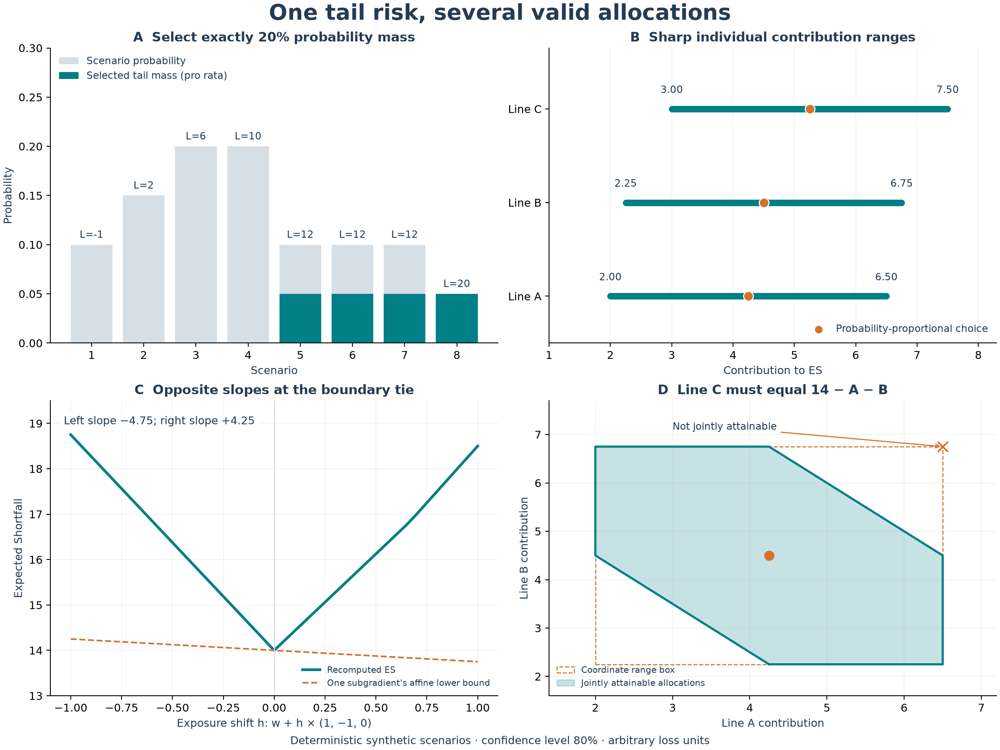

# Tied tail risk allocation

[](https://github.com/lcx0731/tied-tail-risk-allocation/actions/workflows/ci.yml)

An exact finite-scenario Expected Shortfall calculator that exposes ambiguity in
risk contributions at a tail boundary. It returns one reproducible allocation,
sharp ranges for each contribution, and the two directional slopes at a kink.
Each extremum comes with scenario weights that can be checked exactly.

**Educational use only. This is not investment advice or a production capital
allocation system.** All examples use explicitly specified synthetic losses in
arbitrary units. No market data, personal data, or performance claims are used.



## Reproduce

Python 3.11 or later; CI checks 3.11 and 3.13. From a clean checkout:

```bash
python3 -m venv .venv
source .venv/bin/activate
python -m pip install -r requirements.txt
python -m pip install --no-deps .
python -m pip check
python -m pytest -q
python examples/reproduce.py
tail-allocation-demo --output /tmp/tail-allocation-cli.json
cmp results/metrics.json /tmp/tail-allocation-cli.json
```

The package has no runtime dependencies beyond the standard library. The pinned
requirements install the testing, independent linear-programming reference, and
plotting stack; transitive dependencies are not fully locked. The example writes
`results/metrics.json` and `results/allocation_geometry.png`. Exact rational
quantities are JSON strings such as `"17/4"`. The integer direction is a JSON
array of integers. Figures use floating-point display coordinates only.

For a separate reproduction directory:

```bash
python examples/reproduce.py --output /tmp/tail-allocation-results
cmp results/metrics.json /tmp/tail-allocation-results/metrics.json
```

JSON is deterministic and checked byte for byte in CI. Image appearance can
vary with fonts and plotting dependencies; PNG bytes are not a cross-platform
reproducibility promise. No network access is needed after installation.

## Synthetic result

The complete fixture is in `src/tail_allocation/demo.py`. Exposures are
`w = (1, 1, 1)`, confidence is 80%, and the loss matrix is:

| Scenario | Probability | Line A | Line B | Line C | Total loss |
|---|---:|---:|---:|---:|---:|
| 1 | 0.10 | -2 | 1 | 0 | -1 |
| 2 | 0.15 | 1 | 0 | 1 | 2 |
| 3 | 0.20 | 2 | 3 | 1 | 6 |
| 4 | 0.20 | 6 | 3 | 1 | 10 |
| 5 | 0.10 | 10 | 1 | 1 | 12 |
| 6 | 0.10 | 1 | 10 | 1 | 12 |
| 7 | 0.10 | 1 | 1 | 10 | 12 |
| 8 | 0.05 | 5 | 6 | 9 | 20 |

The worst 20% probability mass contains all 5% at loss 20 and 15% of the 30%
mass at loss 12. Thus ES is `(0.05 × 20 + 0.15 × 12) / 0.20 = 14`.
The default choice selects 5% from each boundary scenario, giving normalized
tail weights `q = (0, 0, 0, 0, 1/4, 1/4, 1/4, 1/4)`.

| Contribution | Default choice | Sharp minimum | Sharp maximum |
|---|---:|---:|---:|
| A | 4.25 | 2.00 | 6.50 |
| B | 4.50 | 2.25 | 6.75 |
| C | 5.25 | 3.00 | 7.50 |

Every valid **joint** allocation sums to 14. The individual maxima sum to 20.75,
so they cannot all hold together. Panel D shows the six-vertex feasible polygon
in the A/B plane, with C determined by the sum constraint. These are optimization
ranges under a fixed model, **not statistical confidence intervals**.

Two controls make the ambiguity visible:

* Averaging every scenario whose loss is at least 12 gives `92/7 ≈ 13.143`,
  not ES. That calculation averages 35% probability mass instead of 20%.
* Along the exposure direction `(1, -1, 0)`, the left slope is `-19/4` and the
  right slope is `17/4`. The default subgradient gives `-1/4`; its affine
  prediction is a supporting lower bound, not either one-sided derivative.

The example verifies the slopes with exact differences at step `1/1000` and
recomputes the whole stress curve. Directional slopes are local: larger shocks
can change which other scenarios enter the tail, as the positive side of panel C
illustrates. Nothing here estimates losses or probabilities from observations.

## Method and exact certificates

Let `X[i,j]` be a scenario's loss per unit exposure, `w[j]` the exposure, and
`z[i] = Σ_j X[i,j] w[j]`. Probabilities are strictly positive and sum to one.
They do not depend on `w`. For confidence `0 ≤ α < 1`, define `τ = 1 − α`.
The finite-scenario primal and dual forms are

```text
ESα(z) = min_c { c + (1/τ) Σ_i p[i] max(z[i] − c, 0) }
       = max_q { Σ_i q[i] z[i] : Σ_i q[i] = 1, 0 ≤ q[i] ≤ p[i]/τ }.
```

The discrete-loss definition and minimization formulation follow
[Rockafellar and Uryasev, Conditional Value-at-Risk for General Loss Distributions](https://sites.math.washington.edu/~rtr/papers/rtr187-CVaR2.pdf).
The paper explains why conditioning on an entire atom at the threshold need
not give the same quantity. This repository implements the finite linear-loss
case and derives its allocation checks from the displayed dual problem; it
does not introduce a new risk measure or estimation method.

**Tail face.** Sort losses in descending order and stop when accumulated
probability reaches `τ`. Call that loss `c`. Every optimal weight has
`q[i] = p[i]/τ` above `c` and `q[i] = 0` below `c`. The remaining mass `r` is
distributed among scenarios equal to `c`, subject to their individual caps.
Consequently, ES is the fixed contribution above the cutoff plus `r × c`.
Moving weight from a smaller loss to an unsaturated larger loss improves the
objective, which proves this characterization.

`cutoff` is a valid minimizing tail threshold, **not an API for lower-quantile
VaR**. At an exact cumulative-probability breakpoint, minimizing thresholds
may form an interval and the descending scan can choose its upper endpoint.
At `α = 0`, the implementation returns the ordinary expectation.

**Default allocation.** The representative divides `r` among boundary scenarios
in proportion to their original probabilities. It is invariant to row order
and splitting a scenario into identical subrows. It is one choice among
potentially many, without a claim of unique economic fairness.

**Sharp extremes.** For any requested linear score `s[i]`, fill the boundary
caps in ascending or descending score order. An exchange from a smaller score
to a larger unsaturated score proves optimality for maximization; reverse the
argument for minimization. The returned `q` is certified by checking all bounds,
unit total mass, and exact equality `q·z = ES`. Ties in the secondary scores
use input order for the witness, without affecting the extreme value.

**Contributions and slopes.** Every optimal `q` gives a subgradient
`g = Xᵀq`. Its allocation `C[j] = w[j]g[j]` sums exactly to ES because
`Σ_j C[j] = q·Xw = q·z`. Contribution bounds optimize the score `w[j]X[i,j]`;
this also handles negative and zero exposures without a sign shortcut.
For direction `d`, minimize/maximize `s[i] = X[i,:]·d` over the tail face.
The resulting minimum and maximum are respectively the left and right slopes
of `ES(w + h d)` at zero. ES is a maximum of finitely many linear functions,
so its local directional slopes come from the active maximizers.

Multiple optimal scenario weights do not necessarily imply multiple gradients:
identical scenario rows can map all witnesses to the same `g`. Conversely,
zero exposures force all contributions to zero even when directional slopes
differ. Tests cover both cases.

## API example

```python
from tail_allocation import Portfolio

p = Portfolio(
    assets=[(10, 0), (0, 10), (0, 0)],
    weights=[1, 1],
    probabilities=["0.1", "0.1", "0.8"],
    alpha="0.9",
)
assert p.tail.es == 10
assert p.contributions() == (5, 5)
assert p.contribution_bounds() == ((0, 10), (0, 10))
assert p.directional_bounds([1, -1]) == (-10, 10)
value, witness = p.tail.extreme([1, -1, 0])
p.tail.certify(witness)
assert value == 1
assert p.contributions(witness) == (10, 0)
```

Supply integers, `fractions.Fraction`, or rational/decimal strings. Binary floats
and booleans are rejected. The code never guesses a rounding tolerance or
normalizes probabilities silently. Arrays and probabilities are copied into
immutable tuples. `TailRisk` can also be used directly without a portfolio.

## Validation and scope

The 23 test cases include a box-edge vertex enumerator using exact rational
arithmetic on 32 seeded small problems, an independent primal breakpoint
formula, and SciPy/HiGHS primal and allocation-face programs on 13 portfolios.
The enumerator does not use the production sorting or boundary-fill algorithm.
Tests also check sharpness, full allocation, subgradient inequalities, negative
exposures, confidence endpoints, row permutation, scenario splitting, malformed
inputs, and the installed CLI from outside the repository. CI additionally runs
the full figure/JSON example and compares exact output with the committed file.

Runtime sorts `n` losses once (`O(n log n)` comparisons). Each linear extreme
uses `O(n + b log b)` operations for `b` boundary rows; coordinate ranges repeat
that computation per exposure. These counts omit rational-arithmetic bit costs.
Exact numerators and denominators can grow, so this implementation targets small
auditable scenario sets rather than high-throughput risk systems.

No sampling uncertainty, stress-scenario plausibility, liquidity, transaction
costs, regulatory eligibility, probability estimation, or nonlinear repricing is
modeled. Exact equalities apply to the supplied rational data; rounding real
observations can create or remove ties and must be an explicit modeling decision.
The one-sided sensitivity formula assumes fixed probabilities and linear losses.
Finite-shock risks should be recomputed. The code and illustrations are original
implementations of standard finite-dimensional risk and optimization ideas.

Released under the [MIT License](LICENSE).
